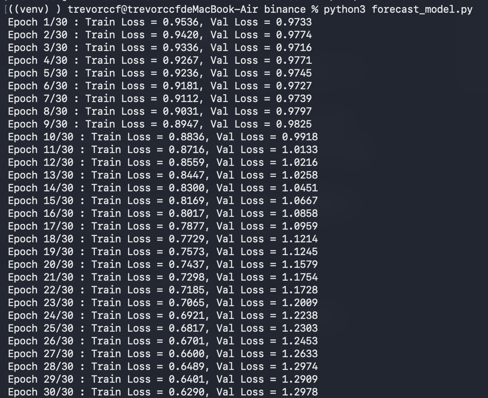

# Crypto Predictor

A work-in-progress pipeline that collects crypto market and social data, trains a PyTorch LSTM to classify short-term price direction, and (planned) hands the signal to an LLM agent that researches news and acts as an analyst.

> **Status: in progress.** Data pipeline and baseline LSTM are working. The model currently overfits and has only a weak signal (see [Results](#results)). The LangChain analyst agent is not built yet.

## Pipeline

1. **Collect data** – 30-minute candles for BTCUSDT, ETHUSDT, SOLUSDT, BNBUSDT from Binance (incremental updates, stored in SQLite). Tweets from a few crypto influencers via twitterapi.io.
2. **Score tweets** – sentiment with a Hugging Face model (`ElKulako/cryptobert`). Not yet used as a model feature.
3. **Build features and labels** – technical indicators and a direction label (below).
4. **Train** – PyTorch LSTM (`forecast_model.py`).
5. **Planned** – when the model signals several consecutive rises, trigger a LangChain agent to search news and judge whether it is worth buying.

## Features

All features are relative / scale-free (no raw price), so they stay comparable across time and symbols:

`dist_ma25`, `ma_spread` (MA7 vs MA25), `RSI` (14), `ATR_percentage` (ATR14 / close), `log_return`, `consecutive_up`, `consecutive_down`

## Label

For each candle, look at the next 5 candles and an ATR band of ±1.75 × ATR around the close:

| Label | Meaning |
|---|---|
| `1` | price first breaks the upper band |
| `-1` | price first breaks the lower band (also used if both break in the same candle) |
| `0` | neither band is broken |

## Model setup

- Input: 60 past candles × 7 features, sliding window
- LSTM (2 layers, hidden size 64, dropout 0.2) → linear head
- Output: 3-class prediction for each of the next 5 steps
- Loss: cross-entropy; optimizer: Adam (lr 1e-3), batch size 64, gradient clipping 1.0
- Evaluation: **chronological 80/20 split** (no shuffling across the split); feature standardization uses **training-set mean/std only** to avoid data leakage

## Results

Run on BTCUSDT only (30 epochs):



| Epoch | Train loss | Val loss |
|---|---|---|
| 1 | 0.9536 | 0.9733 |
| 3 | 0.9336 | 0.9716 (lowest) |
| 6 | 0.9181 | 0.9727 |
| 10 | 0.8836 | 0.9918 |
| 20 | 0.7437 | 1.1579 |
| 30 | 0.6290 | 1.2978 |

**Observations**

- Validation loss is essentially flat for the first ~7 epochs (0.971–0.977, lowest at epoch 3), then rises steadily while training loss keeps falling. This is overfitting: the model starts memorising noise in the training set.
- The best validation loss (~0.972) is only slightly below the uniform-guess level for 3 classes (ln 3 ≈ 1.099). The signal is weak, which is expected for short-horizon crypto prediction. Class imbalance has not been checked yet, so a majority-class baseline is still needed before drawing conclusions.

## Next steps

- [ ] Save the best checkpoint and add early stopping
- [ ] Compare against a majority-class baseline; report confusion matrix and per-class precision/recall
- [ ] Reduce overfitting (smaller model, more dropout, single-step label)
- [ ] Train on all four symbols and compare
- [ ] Add sentiment features
- [ ] Build the LangChain news-analyst agent

## Setup

```bash
python3 -m venv venv
source venv/bin/activate
pip install -r requirements.txt
```

Create a `.env` file in the project root:

```
TWITTER_API_KEY=your_key_here
```

```bash
python main.py            # update data, features, tweets, sentiment
python forecast_model.py  # train the LSTM
```

## Disclaimer

This is a learning project, not financial advice.
